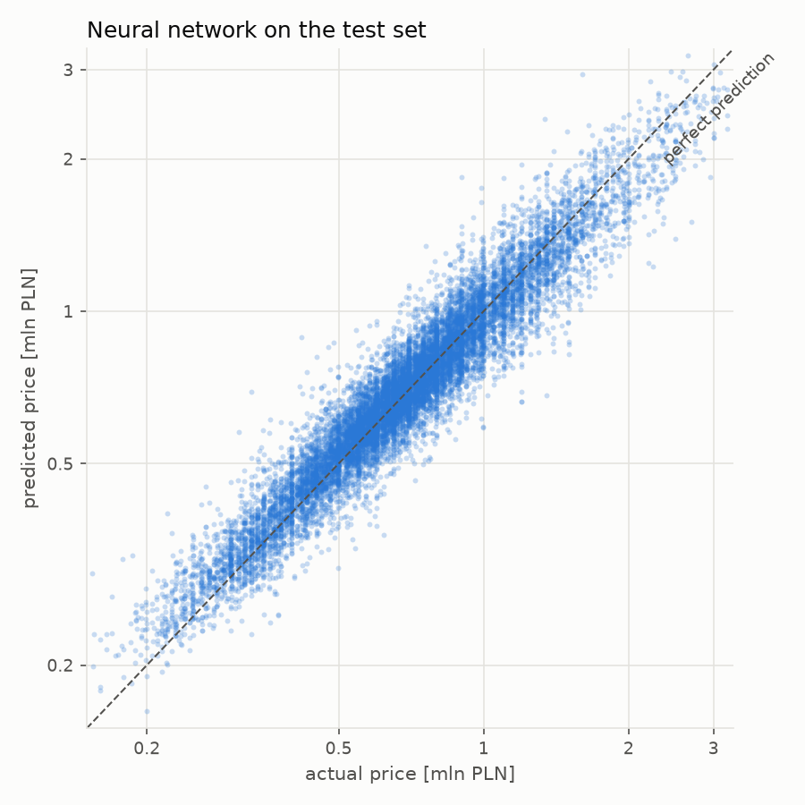
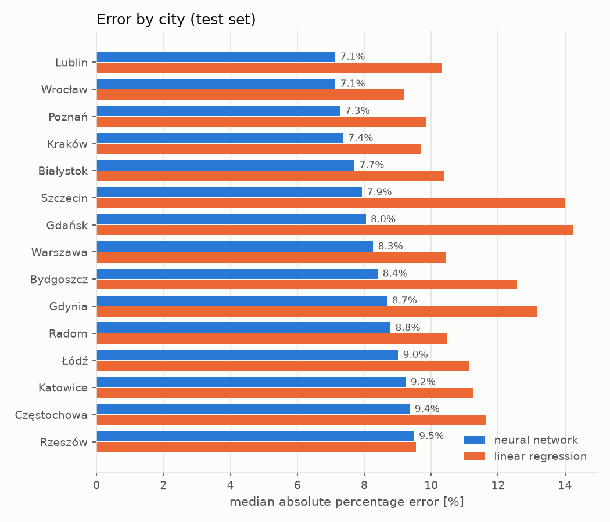
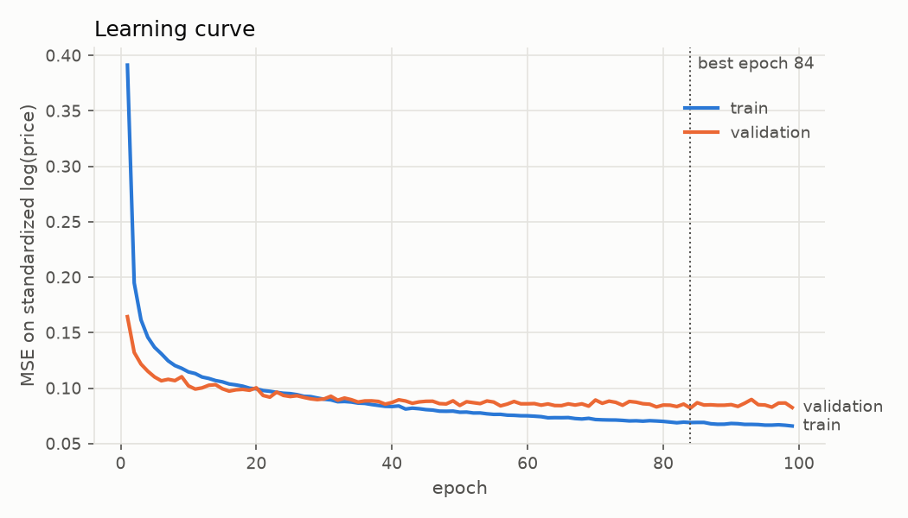

# flat-price-nn


Apartment price estimator for 15 Polish cities, powered by a neural network written **from scratch in NumPy**: no PyTorch, no TensorFlow, no scikit-learn. Layers, backpropagation, optimizers and the training loop are implemented by hand and verified with gradient checking.

On a held-out test set of ~14k listings the network predicts the price with a **median error of 8%** and **R² = 0.90**, beating a linear regression on the same features by a wide margin.

## Results

Test set, 13 945 listings not seen during training or model selection:

| Model | MAE [PLN] | MAPE | Median APE | Within ±10% | R² |
|---|---:|---:|---:|---:|---:|
| City median price per m² × area | 147 997 | 18.6% | 15.3% | 33.5% | 0.68 |
| Linear regression (log price) | 110 875 | 13.7% | 10.7% | 47.4% | 0.79 |
| **Neural network** | **80 849** | **10.4%** | **8.0%** | **59.4%** | **0.90** |

<picture>
  <source media="(prefers-color-scheme: dark)" srcset="reports/figures/predicted_vs_actual_dark.png">
  
</picture>
<picture>
  <source media="(prefers-color-scheme: dark)" srcset="reports/figures/error_by_city_dark.png">
  
</picture>

<picture>
  <source media="(prefers-color-scheme: dark)" srcset="reports/figures/learning_curve_dark.png">
  
</picture>

## How it works

### The network (`nn/`)

A small, general-purpose library:

- `Dense`, `Dropout`, `ReLU`, `Tanh`, `Sigmoid` layers, each with `forward` and `backward`
- `MSE`, `MAE`, `Huber` losses
- `SGD` (with momentum) and `Adam` optimizers, optional L2 weight decay
- `Sequential` model with mini-batch training, early stopping that restores the best weights, save/load to `.npz`

For a dense layer $y = xW + b$ the backward pass, given $\frac{\partial L}{\partial y}$, computes

$$
\frac{\partial L}{\partial W} = x^\top \frac{\partial L}{\partial y}, \qquad
\frac{\partial L}{\partial b} = \sum_{\text{batch}} \frac{\partial L}{\partial y}, \qquad
\frac{\partial L}{\partial x} = \frac{\partial L}{\partial y} W^\top
$$

and passes $\frac{\partial L}{\partial x}$ to the previous layer. `tests/test_gradients.py` compares these analytic gradients with central finite differences for every parameter of a multi-layer network (relative error < 1e-5).

### The model (`flat_price/`)

- **Data:** [Apartment Prices in Poland](https://www.kaggle.com/datasets/krzysztofjamroz/apartment-prices-in-poland), monthly Otodom snapshots from August 2023 to June 2024. The same listing appears in many months, so only its latest snapshot is kept (195k rows → 93k unique listings). Without this, near-identical copies would leak between the train and test sets.
- **Split:** 70% train, 15% validation (early stopping, hyperparameter choice), 15% test (reported once).
- **Features (58):** area, rooms, floor, build year, coordinates, distance to the centre and to schools, clinics, pharmacies etc. (log-scaled), listing month, one-hot city, building type, material, condition and amenities, plus flags for missing floor and build year. All statistics are fitted on the training set only.
- **Target:** standardized $\log(\text{price})$, so the loss penalizes relative rather than absolute errors and expensive apartments do not dominate training.
- **Architecture:** 58 → 256 → 128 → 64 → 1, ReLU, dropout 0.1, Adam (lr 5e-4, weight decay 1e-4), batch 256, early stopping with patience 15. About 56k parameters, trains in under a minute on a CPU.

## Demo

```bash
pip install -e ".[demo]"
python app.py
```

A Gradio form: choose the city, distance to the centre, area, floor, building type and amenities, and get an estimated price with a typical range. The form does not ask for exact coordinates; location features are filled in with medians of training listings in the same city at a similar distance from the centre.

## Quick start

```bash
python -m venv .venv && source .venv/bin/activate
pip install -e ".[dev]"
pytest

# download the dataset (~50 MB, no Kaggle account needed)
curl -L -o data/raw/apartments.zip \
  https://www.kaggle.com/api/v1/datasets/download/krzysztofjamroz/apartment-prices-in-poland
unzip data/raw/apartments.zip -d data/raw && rm data/raw/apartments.zip

python train.py            # trains, prints the comparison table, writes models/ and reports/
python train.py --help     # architecture and optimizer options
```

Training is deterministic for a given `--seed`; the committed model in `models/flat-price/` is the result of `python train.py` with default settings.

## Project structure

```
nn/            neural network library: layers, activations, losses, optimizers, model
flat_price/    data loading, feature encoding, baselines, metrics, predictor, plots
tests/         gradient checks and unit tests
models/        trained model: weights, feature encoder, location lookup table
reports/       test metrics, training history and figures
train.py       training entry point
app.py         Gradio demo
```

## Limitations

- These are **asking prices** from listings, not transaction prices.
- The data ends in June 2024; the model knows nothing about later market changes.
- Listings in the dataset are limited to 25–150 m² and 150k–3.25M PLN; outside that range predictions are extrapolations.
- In the demo, location is approximated by the distance to the centre, so two apartments in very different districts at the same distance get the same location features.

## License

MIT
